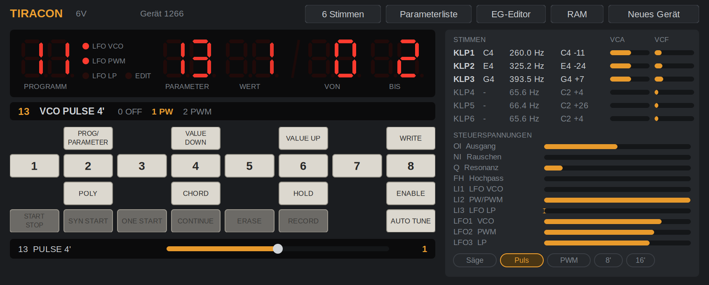

# Tiracon

VST3 instrument by **BecauseOfReasons** · Windows (32/64 bit), Linux

**[Deutsch](#deutsch)** · **[English](#english)**

---

## Deutsch

Tiracon ist eine Emulation des **Tiracon 6V**, eines sechsstimmigen Analogsynthesizers aus der DDR. Im Plugin läuft
die Firmware des Geräts auf einem emulierten Z80 (U880) mit allen Bausteinen der Digitalplatine: Timer, Ein-/Ausgabe,
MIDI-Schnittstelle und dem DAC, über den die Firmware sämtliche Steuerspannungen ausgibt. Dahinter liegt ein
Klangmodell der sechs Stimmkarten (VCO, Teiler, Wellenformen, 24-dB-Tiefpass, VCA) und der Analogplatine. Das Plugin
verhält sich deshalb wie das Gerät: Es bootet, ist ohne AUTO TUNE leicht verstimmt, und Hüllkurven, LFO und
Programme arbeiten so, wie die Firmware sie berechnet.

### Firmware

Eingebaut ist eine erweiterte Fassung der Originalfirmware. Der Sequencer ist entfernt; hinzugekommen sind
**Unison** (P37, bis zu 6 Stimmen pro Note), **Velocity** (P38, auf VCA und/oder Filter), **Pitch Bend** (±1 Halbton),
**Detune** (P45–P48, je Stimmkarte oder schwebend) und **MIDI-CC für alle Parameter**.

### Spielen

* Noten, Velocity und Pitch Bend gelangen über den emulierten MIDI-Eingang an die Firmware. Noten unter MIDI 36
  werden nicht gespielt.
* **CC-Nummer = Parameternummer** wie am Gerät (z. B. CC 13 → P13).
* Alle Klangparameter P11–P76 sind in der DAW automatisierbar. Änderungen am Bedienfeld werden an die DAW gemeldet.
* Die 32 Programmplätze 11–48 stehen als Programmliste der DAW zur Verfügung.

### Bedienfeld

* **Anzeige** wie am Gerät (Programm, Parameter, Wert, Wertebereich) mit kurzer Aufschlüsselung des Werts.
* **Tastenfeld** wie am Original, dazu ein **Regler** für den angezeigten Parameter.
* **Stimmen und Steuerspannungen** in Echtzeit.
* **Parameterliste** im Stil der Parametertafel des Geräts; ein Klick wählt den Parameter.
* **EG-Editor**: Darstellung der Hüllkurve, wie die Firmware sie abarbeitet; die Punkte sind verschiebbar.
* **RAM**: Laden, Speichern und Standard-RAM, siehe [Speicher (RAM)](#speicher-ram).
* **Neues Gerät**: erzeugt eine andere Bauteilstreuung. Jedes „Gerät“ klingt und stimmt leicht anders.

### 12 / 24 / 48 Stimmen

Über das Menü „Stimmen“ in der Kopfzeile laufen 1, 2, 4 oder 8 vollständige Geräte nebeneinander, also 6, 12, 24
oder 48 Stimmen. Jedes Gerät hat die unveränderte Firmware und eigene Bauteilwerte. Noten werden verteilt, Parameter
und Programme gelten für alle Geräte. 48 Stimmen benötigen etwa einen halben CPU-Kern.
Die Summe wird leicht abgesenkt und weich begrenzt, damit volle Akkorde nicht übersteuern: Ein einzelner Ton ist bei
12, 24 und 48 Stimmen um 1,5, 3 und 4,5 dB leiser als bei 6 Stimmen.

### Speicher (RAM)

Das Originalgerät speichert alle Daten in 2 KB batteriegepuffertem RAM. Das Plugin bildet dieses RAM vollständig nach;
jede Instanz besitzt ein eigenes.

**Inhalt**

| Adressen | Inhalt | beim Einschalten |
|---|---|---|
| 2187h | MAST. TUNE | bleibt erhalten |
| 2188h–2407h | 32 Programme à 20 Byte (Plätze 11–48) | bleibt erhalten |
| 2460h–25C3h | Erweiterung der Firmware je Programm: Unison, Velocity, Detune (P37, P38, P45–P48) | bleibt erhalten |
| 2000h–2186h | Arbeitsbereich: Editierpuffer, aktuelles Programm, Stimmen, AUTO-TUNE-Werte, MIDI-Zustand | wird gelöscht |

Dauerhaft sind nur Programme, MAST. TUNE und die Erweiterungsdaten. Eine Klangänderung gelangt erst mit **WRITE** in
einen Programmplatz. Die AUTO-TUNE-Werte gehen wie am Gerät bei jedem Einschalten verloren.

**RAM im DAW-Projekt**

Beim Speichern des Projekts legt das Plugin das vollständige RAM zusammen mit Gerät (Seriennummer), Stimmenzahl und
Lautstärke im Projekt ab. Beim Laden des Projekts:

1. Das RAM wird zurückgeschrieben, die Firmware startet neu und wählt wie das Gerät Programm 11.
2. Nach etwa 1,2 s wählt das Plugin per Programmwechsel das zuvor aktive Programm.
3. Anschließend sendet es alle Parameter, deren Wert vom gespeicherten Programm abwich, also nicht mit WRITE
   gesicherte Änderungen.

AUTO TUNE ist danach erneut auszuführen. Jedes Projekt enthält damit einen eigenen, unabhängigen RAM-Stand; spätere
Änderungen in anderen Projekten oder an der Standard-Datei wirken sich auf ein gespeichertes Projekt nicht aus.

**Standard-RAM**

Die Standard-Datei übernimmt die Rolle der Batterie über Projektgrenzen hinweg:

* Jede **neu eingefügte** Instanz startet mit dem Inhalt dieser Datei; ohne Standard-Datei mit den Werksprogrammen.
  Instanzen aus einem gespeicherten Projekt verwenden stattdessen das RAM des Projekts.
* Ist **„WRITE in Standard-Datei übernehmen“** aktiv, schreibt das Plugin das RAM der Instanz in die Standard-Datei,
  sobald sich die dauerhaften Bereiche ändern, also nach WRITE oder nach dem Speichern von MAST. TUNE. Die Prüfung
  erfolgt etwa alle 0,7 s in einem Hintergrund-Thread. Geschrieben wird atomar (temporäre Datei, danach Umbenennen),
  sodass die Datei nie unvollständig ist.
* Das Laden eines RAM, eines Projekts oder der Werksprogramme löst kein Schreiben aus, ebenso wenig das Bearbeiten
  eines Klangs ohne WRITE.
* Pfad und Option gelten pro Benutzer für alle Instanzen und Projekte. Sie stehen in `%APPDATA%\Tiracon\settings.txt`
  (Windows) bzw. `~/.config/Tiracon/settings.txt` (Linux). Die RAM-Datei selbst kann an beliebiger Stelle liegen.

Einrichten:

1. **RAM → Aktuelles RAM als Standard speichern …** und einen Dateinamen wählen (die Endung `.bin` wird ergänzt).
   Für eine vorhandene Datei stattdessen **Datei als Standard wählen …**.
2. **WRITE in Standard-Datei übernehmen** ist voreingestellt aktiv (Häkchen im Menü).
3. Ab diesem Zeitpunkt steht jedes mit WRITE gesicherte Programm in der Datei und damit in jeder neuen Instanz zur
   Verfügung.

**Gründe für diese Aufteilung**

* *Projekt und Standard getrennt:* Ein Projekt soll beim späteren Öffnen genauso klingen wie beim Speichern, auch wenn
  die Programme inzwischen geändert wurden. Deshalb trägt jedes Projekt sein eigenes RAM.
* *Standard-Datei:* Am Gerät bleibt ein mit WRITE gesichertes Programm dauerhaft erhalten. Ohne Standard-Datei wäre
  ein in einem Projekt entstandenes Programm nur in diesem Projekt vorhanden.
* *Schreiben nur bei WRITE:* Bearbeiten und Laden verändern die Datei nicht. Die Standard-Datei enthält damit nur
  Stände, die ausdrücklich gesichert wurden.
* *Mehrere Instanzen:* Jede Instanz schreibt ihr vollständiges RAM. Wird in zwei Instanzen mit unterschiedlichem
  Programmbestand WRITE ausgeführt, gilt der Stand der zuletzt schreibenden Instanz. Nach dem Laden eines fremden RAM
  schreibt das nächste WRITE dieses RAM vollständig in die Standard-Datei.

**Menü RAM**

| Eintrag | Funktion |
|---|---|
| RAM laden … | lädt eine 2-KB-Datei in diese Instanz (bei 12–48 Stimmen in alle Geräte); Neustart mit Wiederherstellung des Programms |
| RAM speichern … | speichert das aktuelle RAM dieser Instanz als Datei |
| Standard: *Datei* | zeigt die aktuelle Standard-Datei |
| Datei als Standard wählen … | legt eine vorhandene Datei als Standard fest, ohne sie zu laden |
| Aktuelles RAM als Standard speichern … | speichert das RAM und legt die Datei als Standard fest |
| Standard jetzt laden | lädt die Standard-Datei in diese Instanz |
| Standard entfernen | hebt die Zuordnung auf; die Datei bleibt erhalten |
| WRITE in Standard-Datei übernehmen | schaltet das automatische Zurückschreiben ein oder aus |
| Werksprogramme laden | lädt die Werksprogramme in diese Instanz; die Standard-Datei bleibt unverändert |

**Dateiformat:** 2048 Byte, unverändertes Abbild des Bereichs 2000h–27FFh ohne Dateikopf. Dateien der
Browser-Version des Emulators sind kompatibel.

### Download und Installation

Fertige Plugins für Windows (32 und 64 Bit) und Linux stehen unter **[Releases](../../releases)** bereit.

* **Windows:** Ordner `Tiracon.vst3` nach `C:\Program Files\Common Files\VST3` kopieren.
* **Linux:** Ordner `Tiracon.vst3` nach `~/.vst3` kopieren. Benötigt werden die üblichen Desktop-Bibliotheken
  (xcb, cairo, pango); unter Ubuntu/Debian fehlt gelegentlich `libxcb-cursor0`.

Nach dem Laden bootet die Firmware etwa eine Sekunde. Anschließend einmal **AUTO TUNE** ausführen, wie am Gerät.

Bauen aus dem Quellcode und Tests: [vst3/README.md](vst3/README.md)

### Lizenz

Der Quellcode steht unter der MIT-Lizenz, siehe [LICENSE](LICENSE). **Ausgenommen** sind die Firmware und die
Werksprogramme des Originalgeräts, siehe [vst3/firmware/README.md](vst3/firmware/README.md). Verwendeter Fremdcode
(Steinberg VST3 SDK, VSTGUI) und dessen Lizenzen: [THIRD-PARTY-NOTICES.md](THIRD-PARTY-NOTICES.md).

Tiracon ist ein eigenständiges Projekt und steht in keiner Verbindung zum Hersteller des Originalinstruments.

---

## English

Tiracon is an emulation of the **Tiracon 6V**, a six-voice analog synthesizer from the GDR. The plugin runs the
instrument's firmware on an emulated Z80 (U880) together with all components of the digital board: timers, I/O, the
MIDI interface and the DAC through which the firmware outputs every control voltage. Behind it sits a sound model of
the six voice cards (VCO, divider, waveforms, 24 dB low-pass filter, VCA) and the analog board. The plugin therefore
behaves like the instrument: it boots, it is slightly out of tune until AUTO TUNE has run, and envelopes, LFOs and
programs work exactly as the firmware computes them.

### Firmware

The built-in firmware is an extended version of the original. The sequencer has been removed; added are **unison**
(P37, up to 6 voices per note), **velocity** (P38, to VCA and/or filter), **pitch bend** (±1 semitone), **detune**
(P45–P48, per voice card or free-running) and **MIDI CC for all parameters**.

### Playing

* Notes, velocity and pitch bend reach the firmware through the emulated MIDI input. Notes below MIDI 36 are not
  played.
* **CC number = parameter number**, as on the instrument (e.g. CC 13 → P13).
* All sound parameters P11–P76 can be automated in the DAW. Changes made on the panel are reported back to the DAW.
* The 32 program locations 11–48 are available as the DAW's program list.

### Panel

* **Display** as on the instrument (program, parameter, value, value range) with a short breakdown of the value.
* **Keypad** as on the original, plus a **slider** for the displayed parameter.
* **Voices and control voltages** in real time.
* **Parameterliste** (parameter list) in the style of the instrument's parameter chart; a click selects the parameter.
* **EG-Editor**: the envelope as the firmware processes it; the points can be dragged.
* **RAM**: load, save and standard RAM, see [Memory (RAM)](#memory-ram).
* **Neues Gerät** (new device): generates a different set of component tolerances. Every "device" sounds and tunes slightly
  differently.

### 12 / 24 / 48 voices

The "Stimmen" (voices) menu in the header runs 1, 2, 4 or 8 complete instruments side by side, i.e. 6, 12, 24 or 48
voices. Each instrument has the unmodified firmware and its own component values. Notes are distributed; parameters
and programs apply to all instruments. 48 voices take about half a CPU core. The sum is slightly attenuated
and soft-limited so that full chords do not clip: a single note is 1.5, 3 and 4.5 dB quieter at 12, 24 and 48 voices
than at 6 voices.

### Memory (RAM)

The original instrument keeps all data in 2 KB of battery-backed RAM. The plugin emulates this RAM completely; each
instance has its own.

**Contents**

| Addresses | Contents | at power-on |
|---|---|---|
| 2187h | MAST. TUNE | kept |
| 2188h–2407h | 32 programs of 20 bytes (locations 11–48) | kept |
| 2460h–25C3h | firmware extension per program: unison, velocity, detune (P37, P38, P45–P48) | kept |
| 2000h–2186h | work area: edit buffer, current program, voices, AUTO TUNE values, MIDI state | cleared |

Only the programs, MAST. TUNE and the extension data are persistent. A sound edit is stored in a program location only
by **WRITE**. As on the instrument, the AUTO TUNE values are lost at every power-on.

**RAM in the DAW project**

When the project is saved, the plugin stores the complete RAM together with the device (serial number), voice count
and volume in the project. When the project is loaded:

1. The RAM is restored, the firmware restarts and, like the instrument, selects program 11.
2. After about 1.2 s the plugin selects the previously active program with a program change.
3. It then sends every parameter whose value differed from the stored program, i.e. edits not saved with WRITE.

AUTO TUNE has to be run again afterwards. Each project therefore carries its own, independent RAM; later changes in
other projects or to the standard file do not affect a saved project.

**Standard RAM**

The standard file takes the role of the battery across projects:

* Every **newly inserted** instance starts with the contents of this file; without a standard file, with the factory
  programs. Instances from a saved project use the project's RAM instead.
* With **"WRITE in Standard-Datei übernehmen"** (write WRITE to standard file) enabled, the plugin writes the
  instance's RAM to the standard file as soon as the persistent areas change, i.e. after WRITE or after storing
  MAST. TUNE. The check runs about every 0.7 s on a background thread. The file is written atomically (temporary
  file, then rename), so it is never left incomplete.
* Loading a RAM file, a project or the factory programs does not trigger a write, nor does editing a sound without
  WRITE.
* Path and option apply per user to all instances and projects. They are kept in `%APPDATA%\Tiracon\settings.txt`
  (Windows) or `~/.config/Tiracon/settings.txt` (Linux). The RAM file itself can be located anywhere.

Setup:

1. **RAM → Aktuelles RAM als Standard speichern …** (save current RAM as standard) and choose a file name (the
   extension `.bin` is added). For an existing file use **Datei als Standard wählen …** (choose file as standard)
   instead.
2. **WRITE in Standard-Datei übernehmen** is enabled by default (check mark in the menu).
3. From then on, every program saved with WRITE is stored in the file and is available in every new instance.

**Rationale**

* *Project and standard kept separate:* a project should sound the same when it is reopened later, even if the
  programs have been changed in the meantime. Each project therefore carries its own RAM.
* *Standard file:* on the instrument, a program saved with WRITE is kept permanently. Without a standard file, a
  program created in one project would exist only in that project.
* *Writing only on WRITE:* editing and loading leave the file unchanged, so the standard file contains only states
  that were saved explicitly.
* *Several instances:* each instance writes its complete RAM. If WRITE is executed in two instances with different
  sets of programs, the state of the instance that wrote last applies. After a foreign RAM file has been loaded, the
  next WRITE stores that RAM completely in the standard file.

**RAM menu** (the plugin's menus are in German)

| Entry | Function |
|---|---|
| RAM laden … | loads a 2 KB file into this instance (into all instruments at 12–48 voices); restart with program restore |
| RAM speichern … | saves this instance's current RAM to a file |
| Standard: *file* | shows the current standard file |
| Datei als Standard wählen … | sets an existing file as standard without loading it |
| Aktuelles RAM als Standard speichern … | saves the RAM and sets the file as standard |
| Standard jetzt laden | loads the standard file into this instance |
| Standard entfernen | removes the assignment; the file itself is kept |
| WRITE in Standard-Datei übernehmen | switches automatic write-back on or off |
| Werksprogramme laden | loads the factory programs into this instance; the standard file is not changed |

**File format:** 2048 bytes, an unmodified image of the range 2000h–27FFh without a header. Files from the browser
version of the emulator are compatible.

### Download and installation

Ready-built plugins for Windows (32 and 64 bit) and Linux are available under **[Releases](../../releases)**.

* **Windows:** copy the folder `Tiracon.vst3` to `C:\Program Files\Common Files\VST3`.
* **Linux:** copy the folder `Tiracon.vst3` to `~/.vst3`. The usual desktop libraries (xcb, cairo, pango) are
  required; on Ubuntu/Debian `libxcb-cursor0` is occasionally missing.

After loading, the firmware boots for about one second. Then run **AUTO TUNE** once, as on the instrument.

Building from source and tests: [vst3/README.md](vst3/README.md) (German)

### License

The source code is licensed under the MIT license, see [LICENSE](LICENSE). **Excluded** are the firmware and the
factory programs of the original instrument, see [vst3/firmware/README.md](vst3/firmware/README.md). Third-party code
used (Steinberg VST3 SDK, VSTGUI) and its licenses: [THIRD-PARTY-NOTICES.md](THIRD-PARTY-NOTICES.md).

Tiracon is an independent project and is not affiliated with the manufacturer of the original instrument.

---

VST is a registered trademark of Steinberg Media Technologies GmbH.
